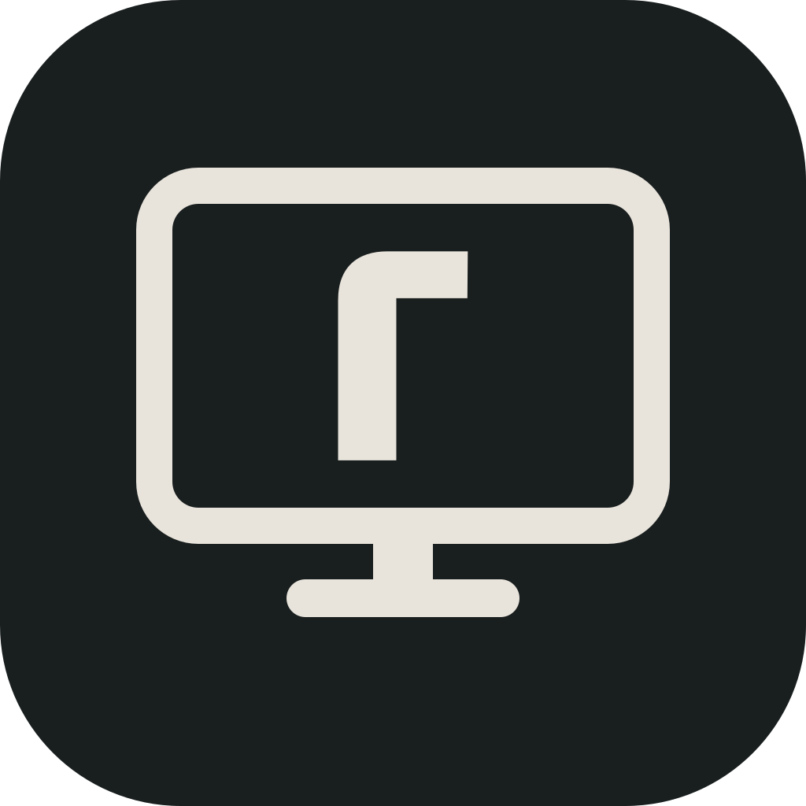

<p align="center">
  <br>
  <b>RuneDesk</b> — remote desktop for your <a href="https://runetale.com">runetale</a> network
</p>

RuneDesk is a remote desktop app for devices on a runetale network. Pick a
device from the list (or type its runetale IP) and connect. There are no
IDs, no relay servers to run and no passwords: if your runetale policy lets
you reach a device, you can control it.

> RuneDesk is a fork of [RustDesk](https://github.com/rustdesk/rustdesk)
> 1.2.4 (Sciter UI), customized to work only on runetale. It is not
> affiliated with or endorsed by the RustDesk project. See
> [License](#license).

## How it differs from RustDesk

| | RustDesk | RuneDesk |
|---|---|---|
| Finding a device | RustDesk ID through a rendezvous server (hbbs) | runetale peer list from the local `runetaled`, or a runetale IP |
| Transport | Direct, NAT traversal or relay (hbbr) | Direct TCP to the peer's runetale IP (port 21118), inside the runetale WireGuard tunnel |
| Who may connect | Anyone with the ID and password | Devices allowed by your runetale ACL policy; the host also checks with its own `runetaled` that the source IP is a runetale peer |
| Passwords | Permanent / one-time password | None (optional "Ask before connecting" approval on the host) |
| Clipboard | Shared | Disabled at build time (`no-clipboard`) |
| Servers / updates | Public servers, update check, NAT test | No rendezvous, relay, NAT test or update check |

### runetale integration

- `src/runetale.rs` talks to the runetale daemon's LocalAPI
  (`GET /localapi/v0/status`) over its unix socket (macOS/Linux) or named
  pipe (Windows). It provides this device's runetale IPs, the peer list for
  the UI, and `whois(ip)` for incoming connections.
- **Authorization.** A runetale IP is bound to a WireGuard key, and the ACL
  decides who can reach whom. When a connection arrives, the host asks its
  own daemon whether the source IP is a known peer; if so the login is
  accepted without a password, otherwise it is refused ("Only devices on
  your runetale network can connect"). It fails closed when the daemon is
  unreachable.
- **Network policy.** Allow TCP 21118 between the devices that should use
  RuneDesk, for example:

  ```json
  {"name": "runedesk", "src": [...], "dst": [...], "ports": "21118", "ip_proto": ["tcp"]}
  ```

### Build features

- Default build: runetale-only, as described above.
- `no-clipboard`: removes clipboard sync in both directions (release builds
  use it).
- `rendezvous`: brings back RustDesk's rendezvous/ID mode. Not used for
  RuneDesk releases.
- `inline`: embeds the UI (`src/ui`) and fonts in the binary (release
  builds use it).

### UI

The Sciter UI was redesigned for runetale: device list with
click-to-connect, runetale palette, and the admin dashboard's typefaces
(Alliance No2, IBM Plex Mono). The remote session toolbar, dialogs and menus
follow the same design.

## Install and use

See **[docs/USAGE.md](docs/USAGE.md)** (Japanese) for installation,
permissions, connecting and troubleshooting.

Installers are on [Releases](https://github.com/runetale/runedesk/releases):

- **macOS** Apple Silicon (11+): `RuneDesk-<version>-macos-arm64.dmg`
- **macOS** Intel (10.15+): `RuneDesk-<version>-macos-x64.dmg`
- **Windows** x64: `RuneDesk-<version>-windows-x64-setup.exe`

Both devices need runetale running and an ACL that allows TCP 21118 between
them.

## Build

Requirements: Rust 1.75, [vcpkg](https://github.com/microsoft/vcpkg)
(`VCPKG_ROOT` set), NASM, and on Windows LLVM 18 for bindgen
(`LIBCLANG_PATH`).

```sh
# native libraries (libvpx, libyuv, opus, aom) via the manifest in vcpkg.json
$VCPKG_ROOT/vcpkg install --triplet arm64-osx        # x64-windows-static on Windows

# development build: loads the UI from ./src/ui, so run it from the repo root
cargo +1.75 build --release --features no-clipboard
./target/release/runedesk

# release build: UI embedded
python3 res/inline-sciter.py
cargo +1.75 build --release --features no-clipboard,inline
./scripts/package-macos.sh        # dist/RuneDesk.app and a dmg
```

The Sciter runtime ships next to the binary: `libsciter.dylib` (macOS, in
this repo) or `sciter.dll` (Windows, from the
[Sciter SDK](https://github.com/c-smile/sciter-sdk)).

## Release

Releases are built by [`.github/workflows/release.yml`](.github/workflows/release.yml):

1. Bump `VERSION` (the RuneDesk version; the crate version stays at the
   RustDesk base because peers compare it).
2. Push a tag `v<VERSION>`.

The workflow builds macOS (arm64 and x64) and Windows (x64), signs them
(Developer ID + notarization, DigiCert KeyLocker), publishes a GitHub
Release with `SHA256SUMS`, and, when the repository secrets `PKG_PREFIX`, `PKG_DIST_BUCKET` and `PKG_DIST_ROLE_ARN` are
set, copies the assets to `pkgs.runetale.com/<PKG_PREFIX>/` (versioned
and latest). Running it by hand builds unsigned artifacts without a
release.

Repository secrets: `DEV_ID_APP_CERT_P12`, `CERT_PASSWORD`, `APPLE_ID`,
`APPLE_TEAM_ID`, `APP_SPECIFIC_PASSWORD`. The DigiCert `SM_*` secrets come
from the organization.

## License

RuneDesk is a modified version of RustDesk and is distributed under the
same license, the [GNU AGPL v3](LICENCE). Anyone who receives a RuneDesk
build must also be able to get its corresponding source code (AGPL §6 and
§13), so keep the source of each released version available to them.

RustDesk is © RustDesk Ltd. and contributors. "RustDesk" is their name;
RuneDesk uses its own name and branding.
